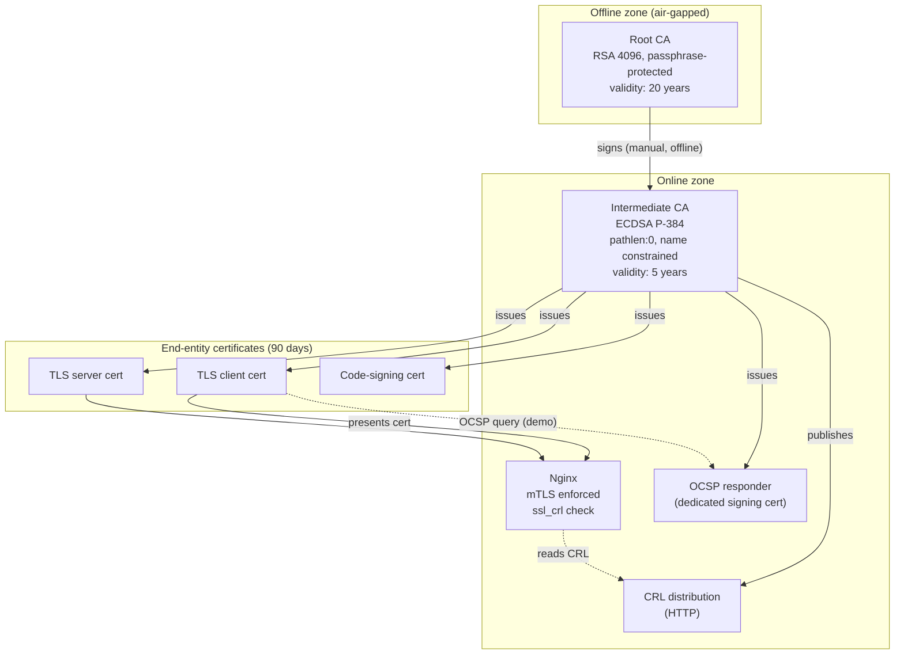

# Two-Tier PKI with Automated Certificate Lifecycle


A small but complete **Public Key Infrastructure** built with OpenSSL: an **offline Root CA**, an **online Intermediate CA**, scripted **issuance, renewal and revocation**, **CRL and OCSP** revocation services, and a real **Nginx service protected by mutual TLS (mTLS)**.


---

## Table of contents

1. [Overview](#1-overview)
2. [Architecture](#2-architecture)
3. [Design decisions](#3-design-decisions)
4. [Certificate profiles](#4-certificate-profiles)
5. [Revocation: CRL and OCSP](#5-revocation-crl-and-ocsp)
6. [Protected service (mutual TLS)](#6-protected-service-mutual-tls)
7. [The `pki-tool` CLI](#7-the-pki-tool-cli)
8. [Repository structure](#8-repository-structure)
9. [Getting started](#9-getting-started)
10. [Testing](#10-testing)
11. [Continuous integration](#11-continuous-integration)
12. [Security and threat model](#12-security-and-threat-model)
13. [Limitations](#13-limitations)
14. [Future work](#14-future-work)
15. [References](#15-references)

---

## 1. Overview

| Component | Role |
|---|---|
| **Root CA (offline)** | Trust anchor. Signs only the Intermediate CA certificate and the root CRL. Never connected to a network. |
| **Intermediate CA (online)** | Day-to-day issuer. Signs server, client and code-signing certificates. Publishes the CRL and signs the OCSP responder certificate. |
| **OCSP responder** | Answers real-time revocation queries (`good` / `revoked` / `unknown`) using a dedicated OCSP signing certificate. |
| **Nginx (mTLS)** | Example protected service. Requires a valid client certificate and rejects revoked ones using the CRL. |
| **`pki-tool`** | Bash CLI wrapping OpenSSL to initialise the CAs and manage the certificate lifecycle. |
| **Test suite + CI** | Positive and negative tests run automatically on every push with GitHub Actions. |

### What this project demonstrates

- Building a CA hierarchy with correct X.509 extensions
- Separating the trust anchor (offline) from the issuing CA (online)
- Issuing certificates with different profiles (server, client, code signing)
- Revoking certificates and publishing revocation data (CRL and OCSP)
- Enforcing mutual TLS on a real service
- Documenting a threat model and key-compromise procedures
- Automating and testing the whole thing

---

## 2. Architecture



### Trust chain

```
Root CA (self-signed)
 └── Intermediate CA
      ├── TLS server certificates
      ├── TLS client certificates
      ├── Code-signing certificates
      └── OCSP responder certificate
```

### Why two tiers?

If the Intermediate CA key is compromised, the Root CA can revoke it and issue a new intermediate without having to redistribute a new trust anchor to every client. If the root key were used for daily issuance, any compromise would force a full rebuild of trust everywhere. Keeping the root offline makes that compromise very unlikely.

---

## 3. Design decisions

### Algorithms

| Entity | Algorithm | Reason |
|---|---|---|
| Root CA | RSA 4096 | Long-lived (20 years), maximum compatibility, conservative choice for a trust anchor. |
| Intermediate CA | ECDSA P-384 | Strong, smaller and faster than RSA, suitable for an online key. |
| Leaf certificates | ECDSA P-256 | Fast handshakes, small certificates, universally supported by modern clients. |

### Validity periods

| Entity | Validity | Reason |
|---|---|---|
| Root CA | 20 years | Rarely changes, redistributing a trust anchor is costly. |
| Intermediate CA | 5 years | Online key, shorter exposure window. Must expire before the root. |
| Leaf certificates | 90 days | Short-lived certificates limit the impact of compromise and justify automated renewal. |
| CRL (intermediate) | 7 days | Refreshed regularly with a realistic `nextUpdate`. |
| CRL (root) | 1 year | Only used to revoke the intermediate, rarely changes. |

### Other choices

- **Random serial numbers** (`-rand_serial`) instead of sequential ones, so serials are not predictable.
- **Single intermediate** for all profiles to keep the project simple. Distinct `extendedKeyUsage` values separate the profiles. In a real deployment, TLS and code signing would use separate intermediates (see [Limitations](#13-limitations)).
- **`index.txt` database** kept in the standard OpenSSL format so that `openssl ca` and `openssl ocsp` work natively together.
- **Bash + OpenSSL** for the CLI: transparent, easy to audit, and shows exactly which OpenSSL commands are being used.

---

## 4. Certificate profiles

### CA certificates

| Extension | Root CA | Intermediate CA |
|---|---|---|
| `basicConstraints` | `critical, CA:true` | `critical, CA:true, pathlen:0` |
| `keyUsage` | `critical, keyCertSign, cRLSign` | `critical, keyCertSign, cRLSign` |
| `subjectKeyIdentifier` | `hash` | `hash` |
| `authorityKeyIdentifier` | `keyid:always` | `keyid:always, issuer` |
| `nameConstraints` | none | `permitted;DNS:lab.local` and `permitted;DNS:.lab.local` (critical) |
| `crlDistributionPoints` | none | URL of the root CRL |

`pathlen:0` guarantees the intermediate **cannot create further sub-CAs**. The name constraint restricts the DNS names the intermediate can validly issue for, and is used in a negative test.

### End-entity profiles

| Extension | `server` | `client` | `codesign` |
|---|---|---|---|
| `basicConstraints` | `critical, CA:false` | `critical, CA:false` | `critical, CA:false` |
| `keyUsage` | `critical, digitalSignature` | `critical, digitalSignature` | `critical, digitalSignature` |
| `extendedKeyUsage` | `serverAuth` | `clientAuth` | `codeSigning` |
| `subjectAltName` | **required** (DNS / IP) | optional (email / DNS) | optional |
| `subjectKeyIdentifier` | `hash` | `hash` | `hash` |
| `authorityKeyIdentifier` | `keyid, issuer` | `keyid, issuer` | `keyid, issuer` |
| `authorityInfoAccess` | OCSP + CA Issuers URLs | OCSP + CA Issuers URLs | OCSP + CA Issuers URLs |
| `crlDistributionPoints` | CRL URL | CRL URL | CRL URL |

> **Why SAN is mandatory on server certificates:** modern browsers and TLS libraries ignore the Common Name and only trust the Subject Alternative Name.

### OCSP responder certificate

Issued by the intermediate with `extendedKeyUsage = OCSPSigning` and `basicConstraints = CA:false`. Using a dedicated certificate means the **intermediate CA key does not have to be used by the OCSP service** to sign responses.

---

## 5. Revocation: CRL and OCSP

### CRL (Certificate Revocation List)

- The Intermediate CA publishes a CRL over HTTP, including `crlNumber` and a realistic `nextUpdate`.
- The Root CA also has a CRL. It is only used to revoke the intermediate, but it completes the chain of trust.
- CRLs are generated with `pki-tool gen-crl` and verified with `openssl verify -crl_check_all`.

### OCSP (Online Certificate Status Protocol)

- A lightweight responder (`openssl ocsp -index ...`) reads the CA database (`index.txt`) and answers `good`, `revoked` or `unknown`.
- Responses are signed with the **dedicated OCSP signing certificate**.
- Issued certificates carry the OCSP URL in their `authorityInfoAccess` extension so clients can discover it.

### Honest note on Nginx

Nginx can check client certificate revocation through **CRL** (`ssl_crl`), but it **does not support OCSP validation of client certificates**. In this project:

| Mechanism | Where it is enforced / demonstrated |
|---|---|
| CRL | **Enforced** by Nginx during the mTLS handshake. |
| OCSP | Provided by the responder and **demonstrated and tested** with `openssl ocsp`. |

---

## 6. Protected service (mutual TLS)

Nginx serves a simple HTTPS page and requires a client certificate signed by this PKI.

Key configuration:

```nginx
server {
    listen 8443 ssl;
    server_name web.lab.local;

    ssl_certificate         /etc/nginx/certs/server.crt;       # leaf + intermediate
    ssl_certificate_key     /etc/nginx/certs/server.key;

    ssl_client_certificate  /etc/nginx/certs/ca-chain.crt;     # trust chain for clients
    ssl_verify_client       on;
    ssl_verify_depth        2;
    ssl_crl                 /etc/nginx/certs/crl-chain.pem;    # intermediate + root CRLs

    ssl_protocols           TLSv1.2 TLSv1.3;

    location / {
        return 200 "Hello $ssl_client_s_dn - mTLS OK\n";
    }
}
```

Expected behaviour:

| Client | Result |
|---|---|
| Valid client certificate | `200 OK` |
| No client certificate | `400 No required SSL certificate was sent` |
| Revoked client certificate (after CRL refresh) | Handshake rejected |
| Expired client certificate | Handshake rejected |
| Certificate issued by an unknown CA | Handshake rejected |

---

## 7. The `pki-tool` CLI

A Bash script wrapping OpenSSL. Passphrases are **never passed on the command line**: they are read from a file or an environment variable (`-passin file:...` / `env:...`).

| Command | Description |
|---|---|
| `pki-tool init-root` | Generate the root key (encrypted) and self-signed root certificate, initialise the root CA database. |
| `pki-tool init-intermediate` | Generate the intermediate key and CSR, then have the root sign it (simulating the offline signing step). |
| `pki-tool issue --profile <server\|client\|codesign> --cn <name> [--san <list>]` | Generate a key and CSR, sign with the intermediate using the chosen profile. |
| `pki-tool renew --serial <serial>` | Issue a new certificate for the same subject with a new serial. The old one stays valid until expiry or revocation. |
| `pki-tool revoke --serial <serial> [--reason <reason>]` | Mark a certificate as revoked in the CA database. |
| `pki-tool gen-crl [--root]` | Generate and publish the intermediate (or root) CRL. |
| `pki-tool gen-ocsp-cert` | Issue the dedicated OCSP signing certificate. |
| `pki-tool list` | List issued certificates and their status. |
| `pki-tool verify <cert>` | Verify a certificate against the chain and CRLs. |

Example session:

```bash
./pki-tool init-root
./pki-tool init-intermediate
./pki-tool gen-ocsp-cert

./pki-tool issue --profile server --cn web.lab.local --san DNS:web.lab.local,IP:127.0.0.1
./pki-tool issue --profile client --cn alice

./pki-tool revoke --serial 4A1F...C3
./pki-tool gen-crl
```

---

## 8. Repository structure

```
pki-project/
├── README.md
├── Makefile
├── pki-tool                    # Bash CLI
├── config/
│   ├── openssl-root.cnf
│   └── openssl-intermediate.cnf
├── services/
│   └── nginx/
│       └── nginx.conf
├── tests/
│   ├── run-all.sh
│   ├── test-chain.sh
│   ├── test-revocation.sh
│   ├── test-negative.sh
│   └── test-ocsp.sh
├── docs/
│   ├── architecture.md
│   └── threat-model.md
├── .github/
│   └── workflows/
│       └── ci.yml
└── .gitignore                  # *.key, private/, *.pem secrets, generated pki/ data
```

> **No private keys are ever committed.** All keys and certificates are generated locally or in CI at runtime and are excluded by `.gitignore`.

---

## 9. Getting started

### Prerequisites

- OpenSSL 3.x
- Bash 4+
- Nginx 
- `curl`, `make`

### Quick start

```bash
git clone https://github.com/<your-username>/pki-project.git
cd pki-project

# Build the whole PKI (root, intermediate, OCSP cert, server and client certs)
make init

# Start the OCSP responder and the mTLS Nginx service
make up

# Valid client: should succeed
curl --cacert pki/ca-chain.crt \
     --cert pki/clients/alice.crt --key pki/clients/alice.key \
     https://web.lab.local:8443/

# Revoke alice and refresh the CRL
make revoke CN=alice

# Same request: should now be rejected
curl --cacert pki/ca-chain.crt \
     --cert pki/clients/alice.crt --key pki/clients/alice.key \
     https://web.lab.local:8443/
```

Add `127.0.0.1 web.lab.local` to `/etc/hosts` to resolve the lab hostname.

### Makefile targets

| Target | Action |
|---|---|
| `make init` | Create the root, intermediate, OCSP cert and sample certificates |
| `make up` / `make down` | Start / stop OCSP responder and Nginx |
| `make test` | Run the full test suite |
| `make revoke CN=<name>` | Revoke a certificate and regenerate the CRL |
| `make clean` | Delete all generated PKI material |

---

## 10. Testing

Tests are shell scripts that build a fresh PKI in a temporary directory and assert the expected results.

### Positive tests

- Root certificate is self-signed and has `CA:true`
- Intermediate chain verifies: `openssl verify -CAfile root.crt intermediate.crt`
- Server and client leaf certificates verify against the full chain
- Extensions are present: SAN, EKU, AIA, CDP, `pathlen:0`
- Valid client certificate is accepted by Nginx (mTLS)
- OCSP responder returns `good` for a valid certificate
- Renewal produces a **new serial** and the old certificate remains valid until expiry

### Negative tests

| Test | Expected result |
|---|---|
| Client certificate used as a server certificate (wrong EKU) | Verification fails |
| Certificate with a name outside the intermediate's constraint | Verification fails |
| Expired certificate (generated with a past `-startdate` / `-enddate`) | Verification fails |
| Tampered certificate | Verification fails |
| Revoked certificate with `-crl_check_all` | Verification fails |
| Revoked client certificate against Nginx | Handshake rejected |
| OCSP query for a revoked certificate | `revoked` |
| OCSP query for a serial the CA never issued | `unknown` |
| CRL contains the revoked serial after `gen-crl` | Serial is present |

Run everything:

```bash
make test
```

---

## 11. Continuous integration

A GitHub Actions workflow (`.github/workflows/ci.yml`) runs on every push and pull request:

1. Checks out the repository
2. Installs OpenSSL, Nginx and dependencies
3. Runs `shellcheck` on all scripts
4. Builds a **fresh PKI from scratch** (no keys stored in the repository)
5. Runs the full test suite
6. Fails the build if any test fails

---

## 12. Security and threat model

The full document is in [`docs/threat-model.md`](docs/threat-model.md). Summary:

### Assets

| Asset | Why it matters |
|---|---|
| Root CA private key | Compromise breaks trust for the entire PKI. |
| Intermediate CA private key | Allows an attacker to issue valid certificates. |
| CA database and CRL integrity | Tampering could hide revocations or revoke valid certificates. |
| Leaf private keys | Allow impersonation of a single server or user. |

### Threats and mitigations

| Threat | Mitigation |
|---|---|
| Theft of the root key | Root is **offline**, key is encrypted with AES-256 and a passphrase, stored on removable media, used only to sign the intermediate and the root CRL. |
| Theft of the intermediate key | Dedicated user, permissions `0400`, runs in an isolated container, `pathlen:0` and name constraints limit the damage. Can be revoked by the root. |
| Passphrase leakage | Passphrases are read from files or environment variables, never from command-line arguments (no exposure in shell history or `ps`). |
| Mis-issuance outside the intended domain | Name constraints on the intermediate. |
| Certificate misuse (e.g. client cert as server cert) | Distinct `extendedKeyUsage` per profile, enforced by verification. |
| Use of a compromised leaf certificate | Revocation through CRL (and OCSP), plus short 90-day validity. |
| Predictable serial numbers | Random serials (`-rand_serial`). |
| Stale revocation data | Realistic `nextUpdate`, scheduled CRL regeneration. |
| Secrets committed to Git | `.gitignore`, keys generated at runtime, CI builds a throwaway PKI. |

### Key compromise procedures

- **Leaf key compromised:** revoke the certificate (`pki-tool revoke`), regenerate and publish the CRL, issue a new certificate with a new key.
- **Intermediate key compromised:** bring the root online in a controlled environment, revoke the intermediate and publish a new root CRL, create a new intermediate, and re-issue all leaf certificates. Clients keep the same trust anchor.
- **Root key compromised:** the trust anchor is lost. Build a new PKI with a new root key and redistribute the new root certificate to every client and server.

---

## 13. Limitations

This is an **educational project**, not a production CA. Known limitations:

- No HSM: keys are protected by file permissions and passphrases only.
- A single intermediate issues all profiles. Production PKIs separate TLS and code-signing hierarchies so that a compromise of one does not affect the other.
- Nginx enforces CRL only. It cannot validate client certificates through OCSP.
- The OCSP responder is `openssl ocsp`, which is single-threaded and meant for demonstration.
- No audit logging, no multi-person key ceremony, no formal CP/CPS.
- CRL distribution relies on plain HTTP (standard for CRL/OCSP, but not highly available here).
- The "offline" root is simulated on the same machine. The documented procedure describes how it would be handled on an air-gapped system.

---

## 15. References

- [RFC 5280: X.509 Certificate and CRL Profile](https://datatracker.ietf.org/doc/html/rfc5280)
- [RFC 6960: Online Certificate Status Protocol (OCSP)](https://datatracker.ietf.org/doc/html/rfc6960)
- [OpenSSL `ca`, `x509v3_config` and `ocsp` documentation](https://www.openssl.org/docs/)
- [Nginx `ngx_http_ssl_module`](https://nginx.org/en/docs/http/ngx_http_ssl_module.html)

> **Disclaimer:** This project is for learning and demonstration purposes. Do not use it to run a production certificate authority.
