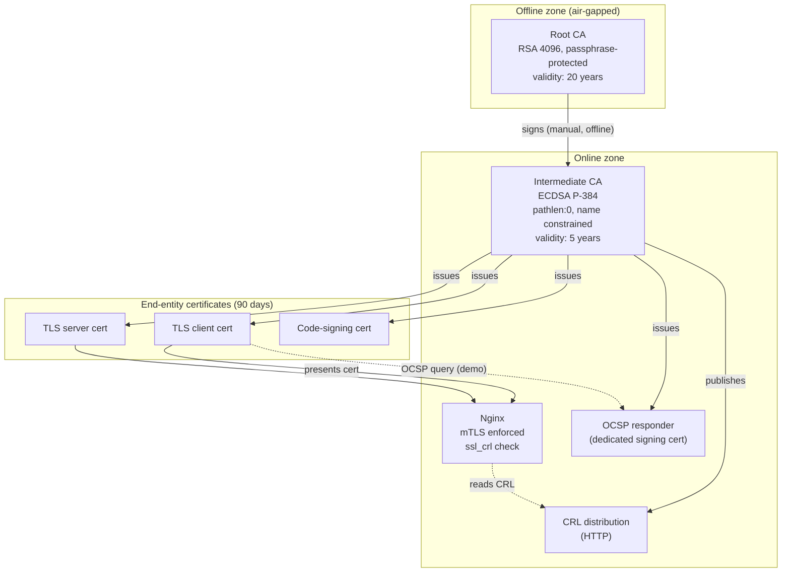

# Architecture

This document describes how the PKI is built and why. It is derived from the project [README](../README.md).

## 1. Components

| Component | Role |
|---|---|
| **Root CA (offline)** | Trust anchor. Signs only the Intermediate CA certificate and the root CRL. Never connected to a network. |
| **Intermediate CA (online)** | Day-to-day issuer. Signs server, client and code-signing certificates. Publishes the CRL and signs the OCSP responder certificate. |
| **OCSP responder** | Answers real-time revocation queries (`good` / `revoked` / `unknown`) using a dedicated OCSP signing certificate. |
| **Nginx (mTLS)** | Example protected service. Requires a valid client certificate and rejects revoked ones using the CRL. |
| **`pki-tool`** | Bash CLI wrapping OpenSSL to initialise the CAs and manage the certificate lifecycle. |
| **Test suite + CI** | Positive and negative tests run automatically on every push with GitHub Actions. |

## 2. Architecture diagram



## 3. Trust chain

```
Root CA (self-signed)
 └── Intermediate CA
      ├── TLS server certificates
      ├── TLS client certificates
      ├── Code-signing certificates
      └── OCSP responder certificate
```

### Why two tiers?

If the Intermediate CA key is compromised, the Root CA can revoke it and issue a new intermediate without having to redistribute a new trust anchor to every client. If the root key were used for daily issuance, any compromise would force a full rebuild of trust everywhere. Keeping the root offline makes that compromise very unlikely.

## 4. Design decisions

### Algorithms

| Entity | Algorithm | Reason |
|---|---|---|
| Root CA | RSA 4096 | Long-lived (20 years), maximum compatibility, conservative choice for a trust anchor. |
| Intermediate CA | ECDSA P-384 | Strong, smaller and faster than RSA, suitable for an online key. |
| Leaf certificates | ECDSA P-256 | Fast handshakes, small certificates, universally supported by modern clients. |

### Validity periods

| Entity | Validity | Reason |
|---|---|---|
| Root CA | 20 years | Rarely changes, redistributing a trust anchor is costly. |
| Intermediate CA | 5 years | Online key, shorter exposure window. Must expire before the root. |
| Leaf certificates | 90 days | Short-lived certificates limit the impact of compromise and justify automated renewal. |
| CRL (intermediate) | 7 days | Refreshed regularly with a realistic `nextUpdate`. |
| CRL (root) | 1 year | Only used to revoke the intermediate, rarely changes. |

### Other choices

- **Random serial numbers** (`-rand_serial`) instead of sequential ones, so serials are not predictable.
- **Single intermediate** for all profiles to keep the project simple. Distinct `extendedKeyUsage` values separate the profiles. In a real deployment, TLS and code signing would use separate intermediates.
- **`index.txt` database** kept in the standard OpenSSL format so that `openssl ca` and `openssl ocsp` work natively together.
- **Bash + OpenSSL** for the CLI: transparent, easy to audit, and shows exactly which OpenSSL commands are being used.

## 5. Certificate profiles

### CA certificates

| Extension | Root CA | Intermediate CA |
|---|---|---|
| `basicConstraints` | `critical, CA:true` | `critical, CA:true, pathlen:0` |
| `keyUsage` | `critical, keyCertSign, cRLSign` | `critical, keyCertSign, cRLSign` |
| `subjectKeyIdentifier` | `hash` | `hash` |
| `authorityKeyIdentifier` | `keyid:always` | `keyid:always, issuer` |
| `nameConstraints` | none | `permitted;DNS:lab.local` and `permitted;DNS:.lab.local` (critical) |
| `crlDistributionPoints` | none | URL of the root CRL |

`pathlen:0` guarantees the intermediate **cannot create further sub-CAs**. The name constraint restricts the DNS names the intermediate can validly issue for, and is used in a negative test.

### End-entity profiles

| Extension | `server` | `client` | `codesign` |
|---|---|---|---|
| `basicConstraints` | `critical, CA:false` | `critical, CA:false` | `critical, CA:false` |
| `keyUsage` | `critical, digitalSignature` | `critical, digitalSignature` | `critical, digitalSignature` |
| `extendedKeyUsage` | `serverAuth` | `clientAuth` | `codeSigning` |
| `subjectAltName` | **required** (DNS / IP) | optional (email / DNS) | optional |
| `subjectKeyIdentifier` | `hash` | `hash` | `hash` |
| `authorityKeyIdentifier` | `keyid, issuer` | `keyid, issuer` | `keyid, issuer` |
| `authorityInfoAccess` | OCSP + CA Issuers URLs | OCSP + CA Issuers URLs | OCSP + CA Issuers URLs |
| `crlDistributionPoints` | CRL URL | CRL URL | CRL URL |

**Why SAN is mandatory on server certificates:** modern browsers and TLS libraries ignore the Common Name and only trust the Subject Alternative Name.

### OCSP responder certificate

Issued by the intermediate with `extendedKeyUsage = OCSPSigning` and `basicConstraints = CA:false`. Using a dedicated certificate means the **intermediate CA key does not have to be used by the OCSP service** to sign responses.

## 6. Revocation: CRL and OCSP

### CRL (Certificate Revocation List)

- The Intermediate CA publishes a CRL over HTTP, including `crlNumber` and a realistic `nextUpdate`.
- The Root CA also has a CRL. It is only used to revoke the intermediate, but it completes the chain of trust.
- CRLs are generated with `pki-tool gen-crl` and verified with `openssl verify -crl_check_all`.

### OCSP (Online Certificate Status Protocol)

- A lightweight responder (`openssl ocsp -index ...`) reads the CA database (`index.txt`) and answers `good`, `revoked` or `unknown`.
- Responses are signed with the **dedicated OCSP signing certificate**.
- Issued certificates carry the OCSP URL in their `authorityInfoAccess` extension so clients can discover it.

### Nginx and revocation

Nginx can check client certificate revocation through **CRL** (`ssl_crl`), but it **does not support OCSP validation of client certificates**. In this project:

| Mechanism | Where it is enforced / demonstrated |
|---|---|
| CRL | **Enforced** by Nginx during the mTLS handshake. |
| OCSP | Provided by the responder and **demonstrated and tested** with `openssl ocsp`. |

## 7. Protected service (mutual TLS)

Nginx serves a simple HTTPS page and requires a client certificate signed by this PKI.

```nginx
server {
    listen 8443 ssl;
    server_name web.lab.local;

    ssl_certificate         /etc/nginx/certs/server.crt;       # leaf + intermediate
    ssl_certificate_key     /etc/nginx/certs/server.key;

    ssl_client_certificate  /etc/nginx/certs/ca-chain.crt;     # trust chain for clients
    ssl_verify_client       on;
    ssl_verify_depth        2;
    ssl_crl                 /etc/nginx/certs/crl-chain.pem;    # intermediate + root CRLs

    ssl_protocols           TLSv1.2 TLSv1.3;

    location / {
        return 200 "Hello $ssl_client_s_dn - mTLS OK\n";
    }
}
```

Expected behaviour:

| Client | Result |
|---|---|
| Valid client certificate | `200 OK` |
| No client certificate | `400 No required SSL certificate was sent` |
| Revoked client certificate (after CRL refresh) | Handshake rejected |
| Expired client certificate | Handshake rejected |
| Certificate issued by an unknown CA | Handshake rejected |

## 8. Limitations

This is an educational project, not a production CA. The known limitations are listed in [`threat-model.md`](threat-model.md#5-limitations).
